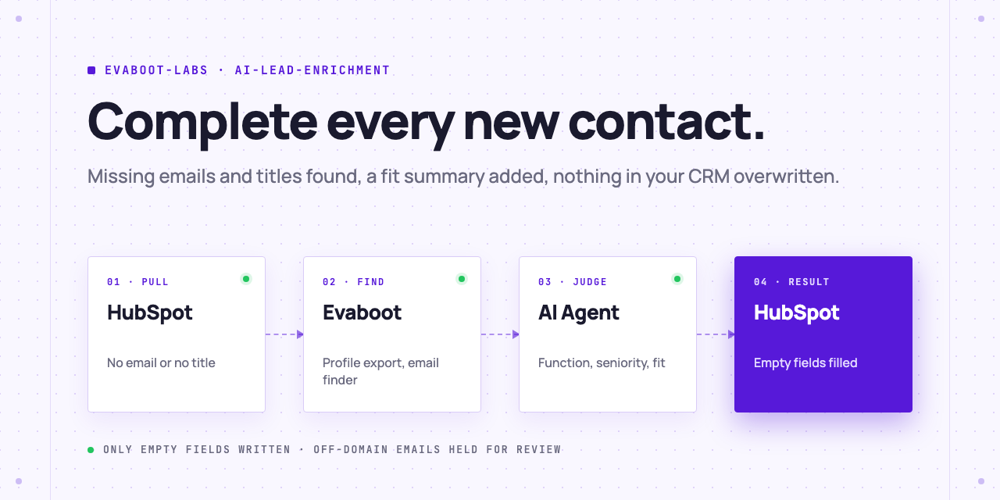
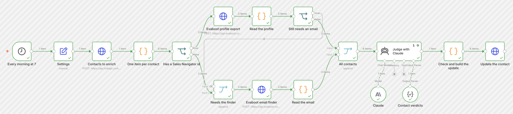

<picture>
  <source media="(prefers-color-scheme: dark)" srcset=".github/assets/banner-dark.png">
  
</picture>

# AI lead enrichment

Your AI Agent finds the HubSpot contacts with no email or no job title, completes them through Evaboot, adds a job function, a seniority and a one-line fit summary, and writes back only the fields your CRM does not already hold.

[](AGENTS.md)
[](https://evaboot.com/mcp)
[](LICENSE)

## Set it up in one prompt

Paste this into Claude Code, Codex or Cursor:

```text
Clone https://github.com/evaboot-labs/ai-lead-enrichment, read AGENTS.md and follow the skill. Enrich my new HubSpot contacts.
```

<details>
<summary>Or install the skill</summary>

Claude Code:

```text
/plugin marketplace add evaboot-labs/ai-lead-enrichment
/plugin install ai-lead-enrichment@evaboot-labs-ai-lead-enrichment
```

Codex, Cursor and other agents:

```bash
npx skills add evaboot-labs/ai-lead-enrichment
```

</details>

## How it works

**1. Only the contacts that need it.** `enrich.py pull` takes the contacts created in the last 7 days with no email or no job title that were never enriched.

**2. An Evaboot waterfall.** A contact with a Sales Navigator id gets a profile export: title, months in role, company size, industry, growth and a verified email. Any other contact, or one the profile did not complete, goes to the email finder on name and company.

```text
$ python3 enrich.py evaboot queue/contacts.json > queue/enriched.json
8 contacts: 3 enriched, 5 email only, 0 not found
```

**3. Your agent judges each contact.** A job function, a HubSpot seniority, a fit (good, maybe or no) and one summary line, from [`FIT.md`](FIT.md). `enrich.py check` rejects a missing field, a seniority HubSpot does not know, a summary over 30 words or a guess at someone's gender.

**4. A careful write-back.** `enrich.py review` shows every change before anything is written. Only empty fields are filled, an email only when Evaboot rates it safe, and an email on another domain than the company's website is held for you to check. In our test, one of eight was.

**5. Or run it in n8n.** Every morning at 7, the same waterfall, Claude and the same rules, straight into HubSpot.



## What you need

- An [Evaboot account](https://dash.evaboot.com/accounts/signup/?last_click_origin=ai-lead-enrichment-repo). The profile export also needs a Sales Navigator seat.
- A HubSpot private app or service key with contact read and write scopes.
- An AI Agent: Claude Code, Codex, Cursor, or the n8n version.
- Python 3.9+, with no packages to install.
- Cost: 1 Evaboot credit per profile export, 1 per email found. Our test of 8 contacts cost 8 credits.

## Go further

| Page | For |
|---|---|
| [docs/connect-your-agent.md](docs/connect-your-agent.md) | The keys, the three HubSpot properties, and the setup by hand |
| [docs/n8n.md](docs/n8n.md) | The same enrichment in n8n, every morning |
| [FIT.md](FIT.md) | Who fits, and the field rules |

---

Agents: start at [AGENTS.md](AGENTS.md) · Built by [Evaboot](https://evaboot.com) · More workflows at [github.com/evaboot-labs](https://github.com/evaboot-labs) · [MIT license](LICENSE)
